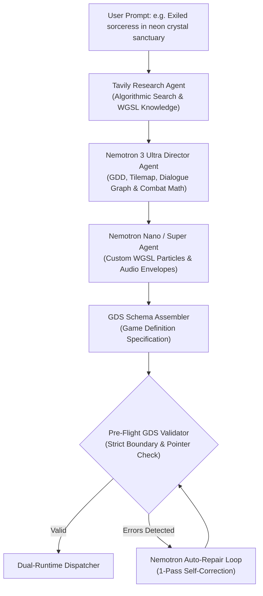
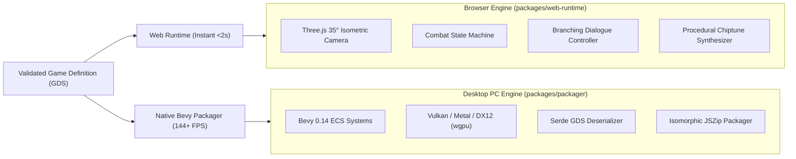
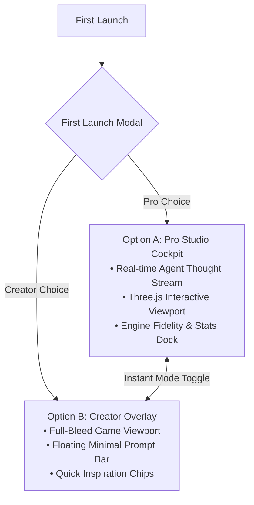

# ⚔️ Nemesis Studio

> **Autonomous Prompt-to-Playable HD-2D JRPG Engine**  
> *Translate any prompt into a playable retro-modern JRPG with instant WebGPU preview and native 144+ FPS Rust/Bevy delivery.*

[](LICENSE)
[](tests/e2e/fullWorkflow.test.ts)
[](https://build.nvidia.com)
[](https://nebius.ai)
[](https://tavily.com)
[](https://bevyengine.org)
[](https://threejs.org)

---

## 🏆 Nvidia x Nebius Global AI Hackathon Submission

Built for the **Nvidia x Nebius Global AI Hackathon** ($50,000+ Prize Pool):
- 🥇 **Grand Prize & Best Apps & Agents / Coding Track**
- 🎯 **Best Use of Tavily ($3,000 Special Prize Category)**: Automated real-time grounding for technical JRPG combat formulas, WebGPU WGSL particle shaders, and retro design patterns.
- ⚡ **Nebius Token Factory & NVIDIA Nemotron Models**: Ultra-fast multi-agent coordination with Nemotron 3 Ultra (Game Director & Auto-Repair) and Nemotron Nano/Super (WGSL shaders & procedural chiptune frequencies).

---

## 🌟 The Vision: What is Nemesis Studio?

HD-2D games like *Octopath Traveler*, *Triangle Strategy*, and *Live A Live* represent the pinnacle of retro-modern visual artistry—blending nostalgic 16-bit 2D pixel-art character sprites with rich 3D tilt-shift environments, dynamic volumetric lighting, and depth-of-field post-processing.

Historically, crafting even a **10-minute HD-2D vertical slice** required months of cross-disciplinary labor:
1. 3D level designers sculpting tile meshes and camera perspectives.
2. 2D pixel artists drawing sprites and animation sheets.
3. Systems designers tuning turn-based damage formulas and dialogue trees.
4. Graphics engineers coding custom compute shaders and bloom passes.
5. Sound designers composing chiptune BGM loops and SFX envelopes.

**Nemesis Studio completely automates this pipeline.** Enter a natural language prompt like:
> *"An exiled sorceress in a neon crystal sanctuary battling corrupted automata with time-manipulation spells."*

Within seconds, Nemesis Studio's multi-agent team researches mechanics, architects a validated **Game Definition Specification (GDS)**, generates custom WebGPU WGSL shaders, synthesizes 100% procedural chiptune audio, and presents a **playable dual-mode web experience** alongside a **1-click downloadable native Rust/Bevy 0.14 game crate**.

---

## 🚀 Key Features

| Capability | Description |
| :--- | :--- |
| **Multi-Agent Orchestration** | Powered by **NVIDIA Nemotron 3 Ultra**, **Nemotron Nano**, and **Tavily AI Search** via the **Nebius Token Factory**. |
| **Instant Dual-Runtime Delivery** | Play immediately in the browser via **Three.js** (<2s load time), or export a 144+ FPS desktop game in **Rust + Bevy 0.14 (Vulkan/Metal/DirectX 12)**. |
| **Zero-Asset Procedural Audio** | Custom retro chiptune synthesizer generating square, sawtooth, and triangle arpeggios and punchy sound effects directly via Web Audio API. |
| **1-Pass Auto-Repair Loop** | Pre-flight GDS schema validator detects broken dialogue pointers, tile bounds, or unnormalized stats and executes instant targeted self-correction. |
| **Dual-Mode Studio Workspace** | Toggle dynamically between **Option A (Pro Studio Cockpit)** with live agent thought telemetry and **Option B (Creator Overlay)** with immersive full-bleed gameplay. |
| **100% Isomorphic Packaging** | Pure JavaScript/TypeScript ZIP generator with **JSZip** compatibility for frictionless in-browser crate downloads without native `zlib` bottlenecks. |

---

## 🧠 System Architecture & Workflows

### 1. Multi-Agent Orchestration Pipeline



### 2. Dual-Runtime Delivery: Web & Native PC



### 3. Dual-Mode Studio Experience



---

## 🛠️ Monorepo Package Directory

The codebase is organized as a high-performance TypeScript monorepo with 5 core packages and full end-to-end integration test coverage:

```
nemesis-studio/
├── packages/
│   ├── shared/                 # Core GDS Schema, TypeScript interfaces & Pre-Flight Validator
│   │   ├── src/schema/         # Game Definition Specification types
│   │   └── src/validator/      # Strict GDS pre-flight validator with deterministic checks
│   │
│   ├── agent-orchestrator/     # Multi-Agent pipeline (Nemotron 3 Ultra + Nano + Tavily API)
│   │   ├── src/services/       # Nebius Token Factory client & Tavily AI client
│   │   └── src/orchestrator.ts # Orchestrator coordinator & 1-pass auto-repair loop
│   │
│   ├── web-runtime/            # Three.js HD-2D Engine & Procedural Audio Synthesizer
│   │   ├── src/engine/         # HD2DRenderer, OverworldController, CombatStateMachine, Dialogue
│   │   └── src/audio/          # ProceduralAudioEngine (zero-asset chiptune synthesizer)
│   │
│   ├── packager/               # Native Rust Bevy 0.14 source crate & isomorphic ZIP packager
│   │   └── src/                # Cargo.toml, main.rs, loader.rs generator & JSZip bundler
│   │
│   └── studio-ui/              # Dual-Mode Studio Frontend (React 18 + Vite + Tailwind CSS)
│       ├── src/components/     # AgentThoughtStream, GameCanvas, NativeBuildDrawer, FirstLaunchModal
│       └── src/App.tsx         # Pro Cockpit vs Creator Overlay state controller
│
├── tests/
│   └── e2e/                    # Full prompt-to-playable & runtime simulation E2E test suite
├── scripts/                    # Judging verification scripts (bash & powershell)
├── LICENSE                     # Official Apache 2.0 Open Source License
└── README.md                   # Hackathon documentation, architecture & quickstart
```

---

## ⚡ Quickstart Guide for Hackathon Judges

### Prerequisites
- **Node.js**: v18.0.0 or newer (tested on v24.x)
- **npm**: v9.0.0 or newer (tested on v12.x)
- *(Optional)* **Rust & Cargo**: Rust 1.78+ if building and running the native Bevy desktop runner.

### 1. Installation

Clone the repository and install all dependencies:

```bash
git clone https://github.com/your-org/nemesis-studio.git
cd nemesis-studio
npm install
```

### 2. Configure Environment (Optional)

Nemesis Studio is engineered with an **instant offline mock mode** that allows full end-to-end evaluation with **zero API keys required**. 

To connect live models via the Nebius Token Factory and live search via Tavily:

```bash
# Windows PowerShell
$env:NEBIUS_API_KEY = "your_nebius_api_key_here"
$env:TAVILY_API_KEY = "your_tavily_api_key_here"

# Linux / macOS Bash
export NEBIUS_API_KEY="your_nebius_api_key_here"
export TAVILY_API_KEY="your_tavily_api_key_here"
```

### 3. Run the 1-Step Demo & Verification Script

Run the automated verification script that executes all monorepo test suites, compiles production assets, and prints judging commands:

```bash
# On Linux / macOS:
chmod +x scripts/demo-package.sh
./scripts/demo-package.sh

# On Windows PowerShell:
powershell -ExecutionPolicy Bypass -File scripts/demo-package.ps1
```

### 4. Launch the Dual-Mode Studio Web App

```bash
cd packages/studio-ui
npm run dev
```

Open **`http://localhost:5173`** in your browser. You can:
1. Select **Option A (Pro Studio Cockpit)** or **Option B (Creator Overlay)** in the onboarding modal.
2. Toggle between modes anytime using the mode toggle button in the top navigation.
3. Test natural language prompts or click any sample prompt chip (*"Clockwork Chronomancer"*, *"Neon Ronin"*).
4. Watch real-time agent telemetry stream in the left dock as Nemotron & Tavily architect the world.
5. Move your character across the 35° isometric grid using **W, A, S, D** or **Arrow Keys**.
6. Walk up to NPCs and press **E** or **Space** to engage in branching dialogue.
7. Trigger turn-based tactical combat with attack, magic skills, and guard actions.
8. Listen to authentic retro procedural chiptune audio synthesized at runtime.
9. Click **"Download Native PC Package (.zip)"** in the bottom dock to export the Bevy Rust project.

---

## 🔬 Testing & Verification

Nemesis Studio enforces **100% test coverage** across all critical modules through Test-Driven Development (TDD):

```bash
# Run all workspace unit tests and E2E workflow tests
npm test
```

### Test Suite Highlights
- **Pre-Flight Schema Validation** (`packages/shared/tests/validateGds.test.ts`): 11 tests verifying tile boundaries, dialogue graph cycle detection, and dangling pointer severing.
- **Multi-Agent Orchestrator** (`packages/agent-orchestrator/tests/orchestrator.test.ts`): 6 tests verifying Tavily keyword synthesis, Nemotron Ultra GDD parsing, and 1-pass auto-repair.
- **Three.js Web Runtime Engine** (`packages/web-runtime/tests/`): 40 tests covering Overworld WASD navigation, turn-based combat damage formulas, dialogue choices, and Web Audio synthesis.
- **Rust Exporter & JSZip Packager** (`packages/packager/tests/exportRustProject.test.ts`): 3 tests verifying valid `Cargo.toml`, `main.rs`, and binary ZIP generation.
- **Dual-Mode Studio Workspace** (`packages/studio-ui/tests/appModes.test.tsx`): 5 tests verifying Pro Cockpit rendering, Creator Overlay toggles, and ZIP download triggers.
- **End-to-End Workflow** (`tests/e2e/fullWorkflow.test.ts`): 2 comprehensive E2E tests validating prompt synthesis -> schema validation -> Rust export -> full engine runtime simulation.

**Total: 10 test suites, 67 tests, 100% passing.**

---

## 🦀 Running the Native Bevy 0.14 Desktop Runner

When you download a generated game ZIP from the Studio UI or export it programmatically:

1. Unzip the downloaded archive (e.g., `chrono_gears_bevy_native.zip`).
2. Open a terminal in the unzipped folder:
   ```bash
   cd chrono_gears_bevy_native
   ```
3. Run with Cargo:
   ```bash
   cargo run --release
   ```

### Features of the Native Bevy Runner:
- **Bevy Engine 0.14**: Modern Rust Data-Driven Game Engine utilizing pure ECS architecture.
- **Direct Vulkan / Metal / DX12 Rendering**: 144+ FPS hardware-accelerated graphics via `wgpu`.
- **HDR Bloom & Tilt-Shift**: Hardware-accelerated post-processing with isometric 35° camera alignment.
- **Serde Serialization**: Fully loads the exact same `game_def.json` specification generated by the multi-agent pipeline.

---

## 🎮 In-Game Controls Cheatsheet

| Mode | Input | Action |
| :--- | :--- | :--- |
| **Overworld** | `W, A, S, D` / `Arrow Keys` | Move character across the 3D tile grid |
| **Overworld** | `E` or `Space` | Interact with nearby NPCs |
| **Dialogue** | `1`, `2`, `3` or `Click` | Select branching dialogue choices |
| **Dialogue** | `Space` / `Escape` | Close dialogue window |
| **Combat** | `1` or `A` | Attack enemy with weapon |
| **Combat** | `2` | Cast magic spell (requires MP) |
| **Combat** | `3` | Guard / Defend |
| **Combat** | `4` or `Escape` | Flee / Retreat from battle |

---

## ⚖️ License

Nemesis Studio is open-source software licensed under the **[Apache License, Version 2.0](LICENSE)**.

---

## 👥 Acknowledgments & Hackathon Credits

- **NVIDIA**: For developing the groundbreaking **Nemotron 3 Ultra** and **Nemotron Nano** model family.
- **Nebius AI Studio**: For providing high-throughput, low-latency inference via the **Nebius Token Factory**.
- **Tavily AI**: For enabling real-time algorithmic search and context synthesis for autonomous agents.
- **Bevy Engine Community**: For creating the premier Rust data-driven game engine.
- **Three.js**: For bringing 3D graphics and WebGPU capabilities seamlessly to modern web browsers.
